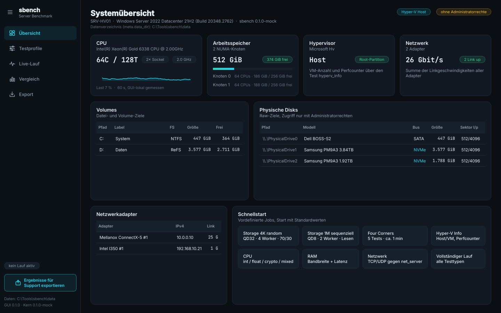
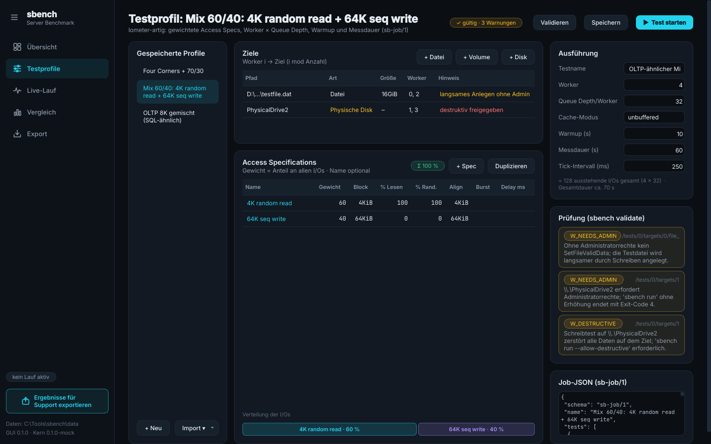
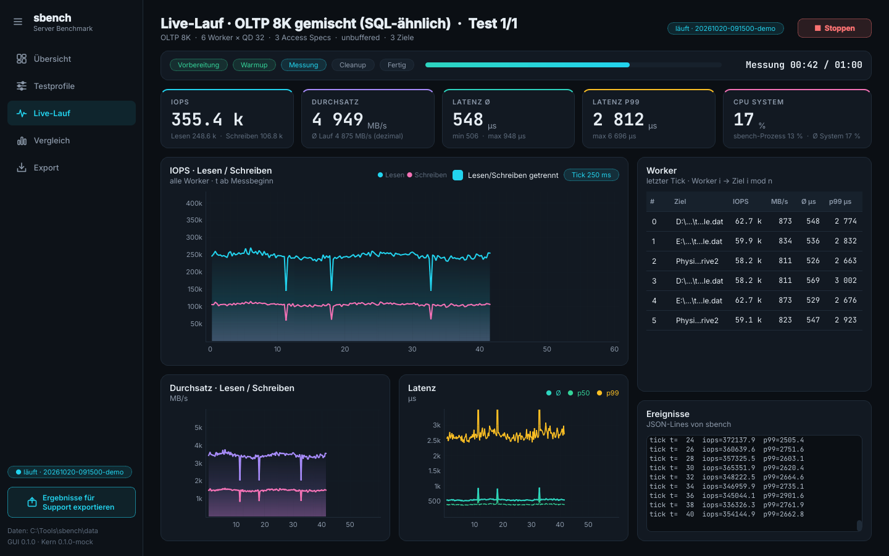
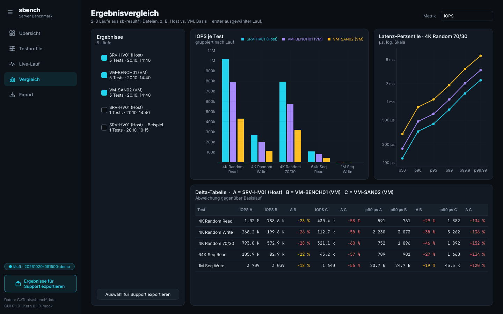
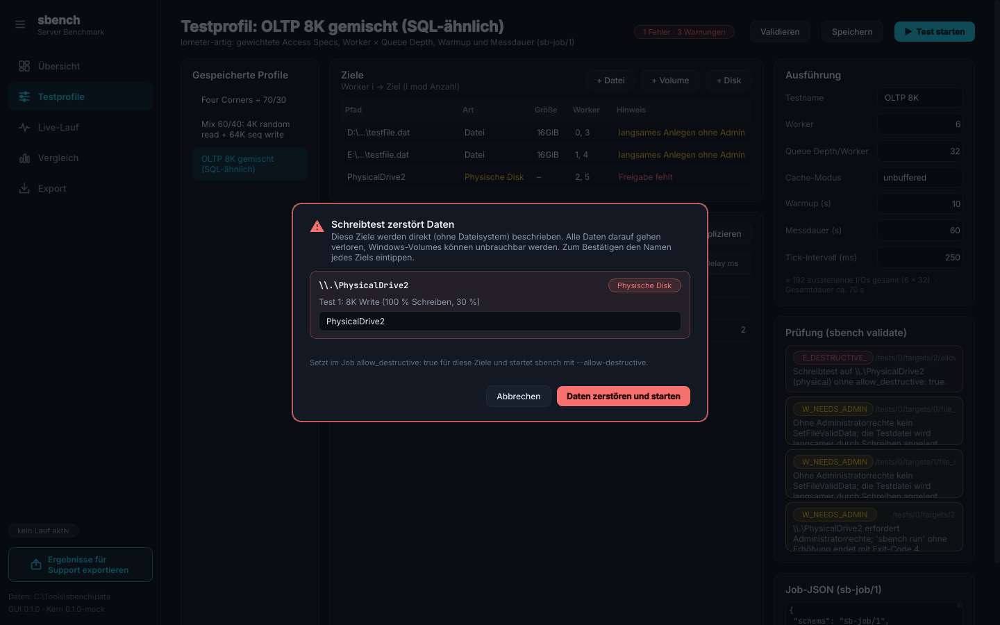
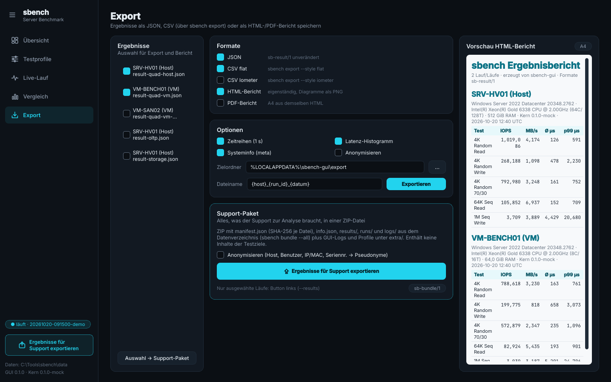

# server-benchmark
Portable Windows-Server-Benchmark mit GUI: Storage-I/O wie Iometer, dazu CPU, RAM, Netzwerk und Hyper-V. Python + C, als fertige portable EXE.

## Projektziel

Ein portables Werkzeug (keine Installation, eine EXE), mit dem sich Windows-Server
schnell und reproduzierbar vermessen lassen:

- **Storage** wie Iometer: Dateien, Volumes und physische Disks, mehrere Worker,
  Queue Depth, mehrere gewichtete Access-Specs (z. B. 60 % 4K random read +
  40 % 64K sequential write), Latenz-Perzentile und Histogramm.
- **CPU** (Integer, Gleitkomma, Krypto, gemischt), **Arbeitsspeicher** (Bandbreite,
  Latenz), **Netzwerk** (TCP/UDP-Durchsatz, Jitter, Verlust, RTT; Client und Server).
- **Hyper-V**: Erkennung von Host/Gast, Hypervisor-Informationen und
  Leistungsindikatoren.

## Architektur

```
┌────────────────────────────┐   Job (JSON)  / Ergebnis (JSON)
│ GUI (Python, PySide6)      │──────────────────────────────┐
│ PyInstaller-EXE            │   Fortschritt (JSON Lines     │
│ startet sbench als         │◄── über stdout/Named Pipe) ── │
│ Unterprozess (ggf. runas)  │   Stop (benanntes Event)      │
└────────────────────────────┘                               ▼
                                          ┌──────────────────────────────┐
                                          │ sbench.exe (CLI)             │
                                          │  └─ C-Messkern (statische    │
                                          │     Lib), zusätzlich als     │
                                          │     sbcore.dll               │
                                          └──────────────────────────────┘
```

- **C-Messkern** als statische Bibliothek; daraus entstehen `sbench.exe` (CLI) und
  `sbcore.dll` (für spätere direkte Einbindung).
- **GUI** in PySide6 steuert ausschließlich die CLI als Unterprozess. Dadurch kann
  der Messkern bei Bedarf erhöht (Administrator) laufen, während die GUI normal läuft.
- Auslieferung der GUI als **PyInstaller-EXE**, die `sbench.exe` mitbringt.
- **Build** per GitHub Actions auf `windows-latest`, nativ für x64 und ARM64 (ab Windows 10 1607 /
  Server 2016, statische CRT); Details unter
  [Build & Plattformen](docs/cli.md#build--plattformen).

## Schnittstellen-Vertrag

- [`schema/`](schema/) – JSON Schemas (draft 2020-12) für Job, Ergebnis,
  Fortschritts-Events, Systeminfo und Validierung, mit Beispielen in
  [`schema/examples/`](schema/examples/).
- [`docs/cli.md`](docs/cli.md) – Befehle, Optionen, Exit-Codes und Rechte von `sbench.exe`.

Beispiele prüfen:

```
pip install jsonschema
python tools/validate_examples.py
```

Die Prüfung läuft automatisch per GitHub Actions bei Änderungen unter `schema/`.

## GUI (Prototyp M1)

Die GUI liegt unter [`gui/`](gui/) (PySide6 + pyqtgraph, steuert nur `sbench.exe`; ohne Kern läuft sie gegen einen Mock).
Plan und Screens: [`docs/GUI_PLAN.md`](docs/GUI_PLAN.md) · Kompatibilität: [`docs/kompatibilitaet.md`](docs/kompatibilitaet.md).
**GUI erfordert Desktop Experience, auf Server Core die CLI nutzen.**

> **Mockup mit Beispieldaten:** Die folgenden Bilder zeigen den Prototyp gegen den Mock-Kern mit erfundenen Werten
> (Host `SRV-HV01`, VMs `VM-BENCH01`/`VM-SAN02`). Es sind keine Messergebnisse. Echte Screenshots
> rendert später `.github/workflows/screenshots.yml` aus dem Smoke-Artefakt `sbench-smoke-windows-2022-x64`.

| | |
|---|---|
| <br>Übersicht – *Mockup mit Beispieldaten* | <br>Testprofil mit gewichteten Access Specs – *Mockup mit Beispieldaten* |
| <br>Live-Lauf – *Mockup mit Beispieldaten* | <br>Vergleich Host/VM – *Mockup mit Beispieldaten* |
| <br>Bestätigung destruktiver Schreibtest – *Mockup mit Beispieldaten* | <br>Export und Support-Paket – *Mockup mit Beispieldaten* |

Weitere Screens (Validierung, Rechte, ICF-Import, Re-Attach, Support-Dialog) in [`docs/img/`](docs/img/), RDP-Größe 1366×768 in [`docs/img/rdp1366/`](docs/img/rdp1366/) – alle *Mockup mit Beispieldaten*.

## Meilensteine

1. **Storage-Kern + Durchstich** – Storage-Test im C-Kern (Dateien, Volumes,
   physische Disks, Worker, Queue Depth, gewichtete Access-Specs, Latenzstatistik),
   `sbench run/stop/validate/info` gemäß Vertrag, minimale GUI, die einen Job startet,
   Live-Werte anzeigt und das Ergebnis lädt; Build per GitHub Actions.
2. **Weitere Tests und Komfort** – u. a. Import von Iometer-Konfigurationen
   (`sbench import-icf`).
