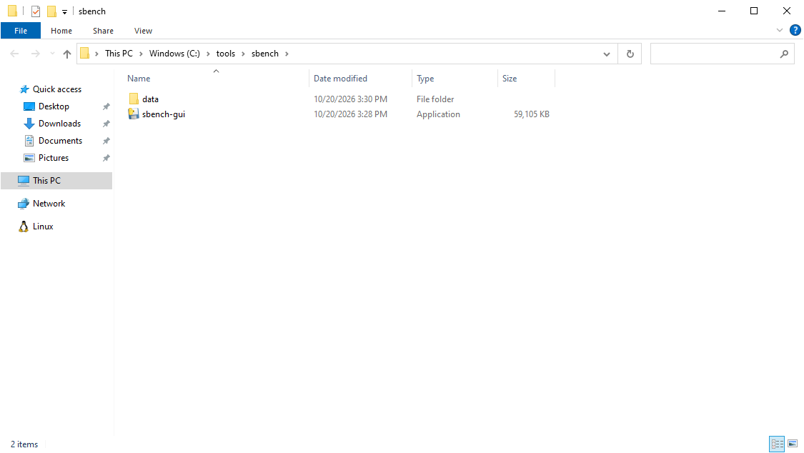
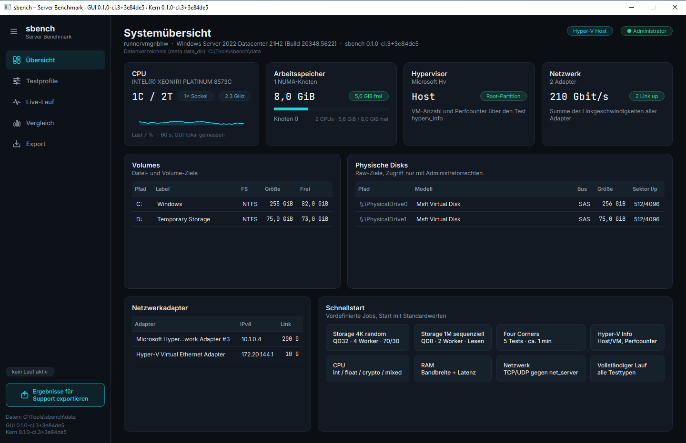
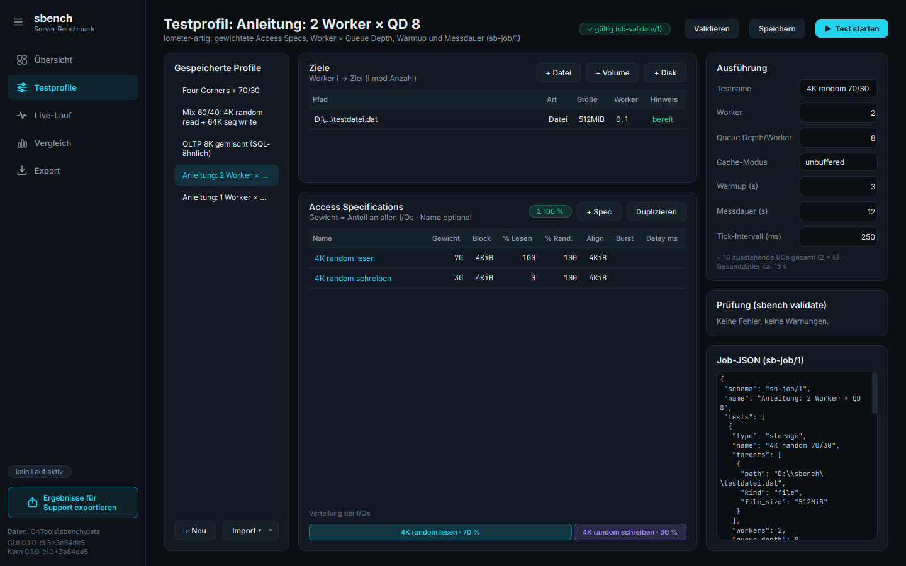
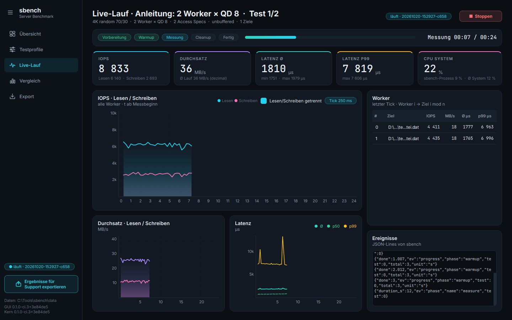
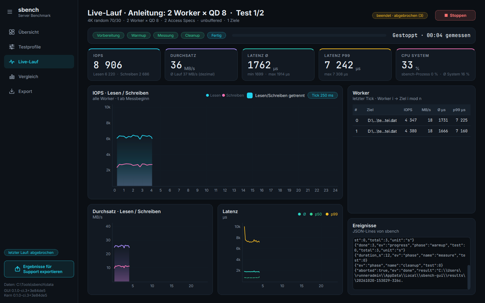
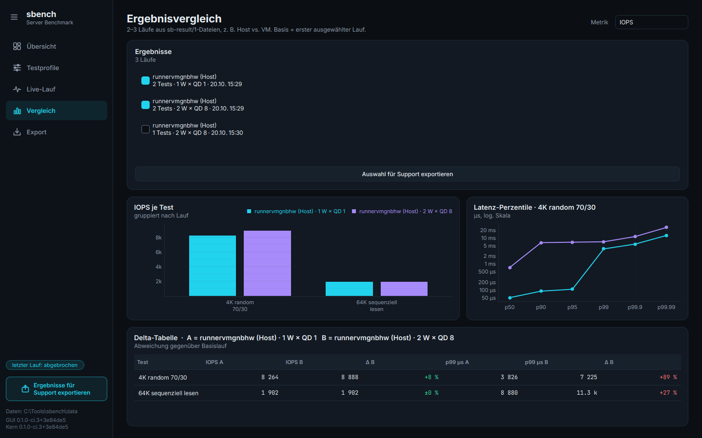
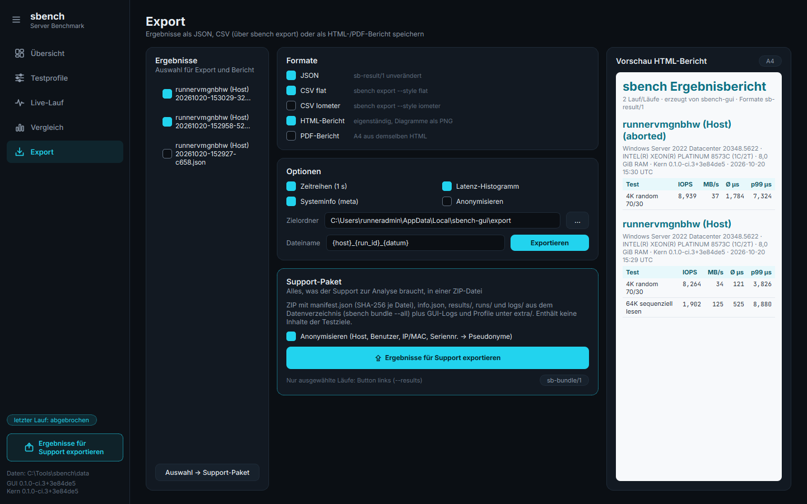
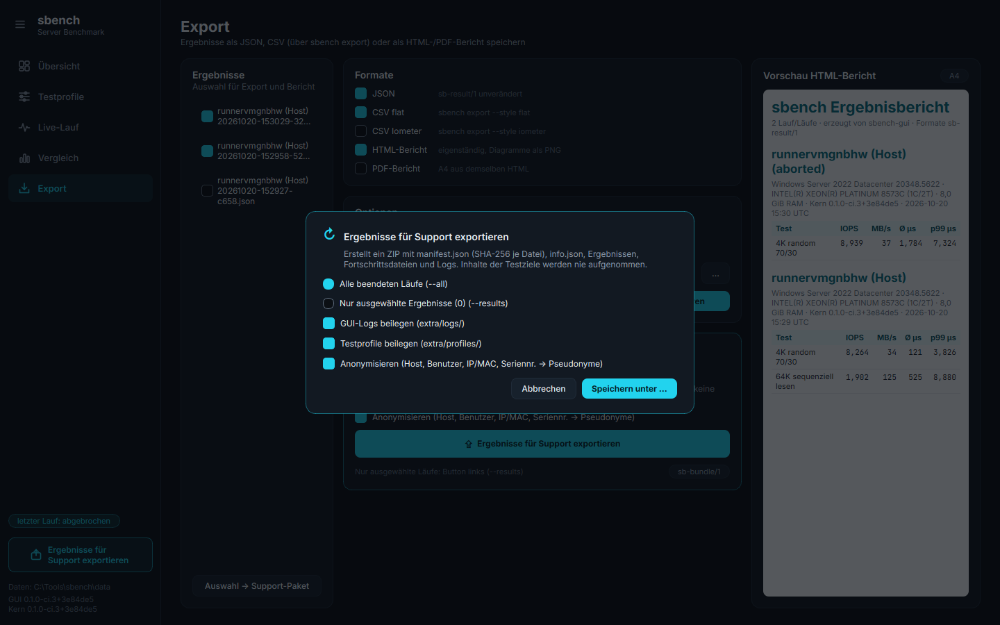
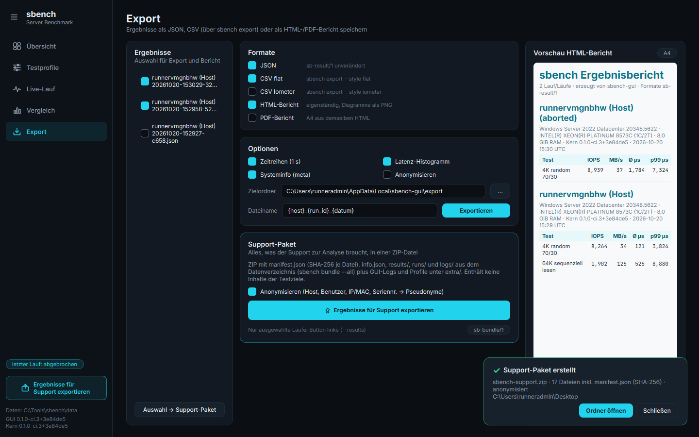
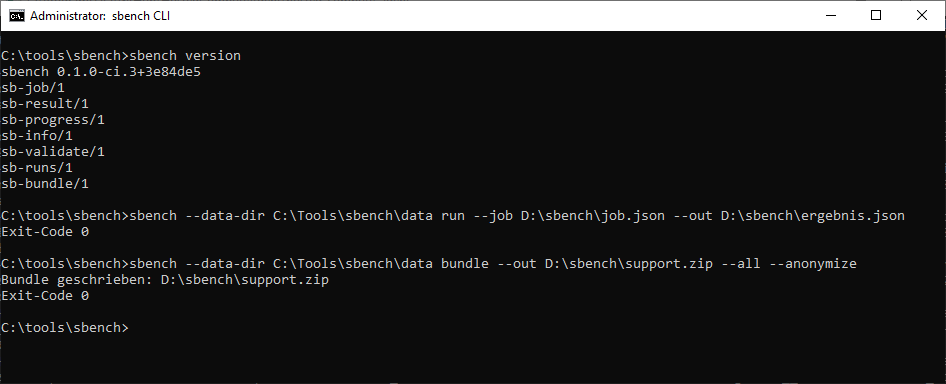

# sbench – Server-Benchmark für Windows

Portables Benchmark-Werkzeug für Windows-Server: Storage-I/O wie Iometer (Dateien, Volumes, Disks,
Worker, Queue Depth, gewichtete Access Specs, Latenz-Perzentile), mit grafischer Oberfläche und
Kommandozeile. Diese Anleitung zeigt Schritt für Schritt, wie Sie einen Test anlegen, beobachten,
vergleichen und uns die Ergebnisse schicken.

> Alle Bilder sind echte Aufnahmen der aktuellen GUI mit dem echten Messkern, aufgenommen in der
> GitHub-Actions-CI auf `windows-2022` (einer Azure-VM). Die Messwerte stammen von diesem Runner,
> nicht von Ihrem Server.

**Inhalt:** [1. Herunterladen und starten](#1-herunterladen-und-starten) ·
[2. Erster Start](#2-erster-start-und-system-übersicht) ·
[3. Storage-Test anlegen](#3-storage-test-anlegen) ·
[4. Live-Lauf](#4-live-lauf-beobachten-und-stoppen) ·
[5. Vergleichen](#5-ergebnisse-vergleichen) ·
[6. Support-Paket](#6-exportieren-und-support-paket-senden) ·
[7. Kommandozeile / Server Core](#7-kommandozeile-und-server-core) ·
[8. Kompatibilität](#8-kompatibilität)

## 1. Herunterladen und starten

Laden Sie unter [Releases](../../releases) die Datei `sbench-gui-<version>-x64.zip` herunter, entpacken
Sie `sbench-gui.exe` in einen beliebigen Ordner (z. B. `C:\Tools\sbench`) und starten Sie sie per
Doppelklick. Eine Installation ist nicht nötig. Beim ersten Start legt die GUI daneben den Ordner
`data\` für Ergebnisse, Logs und den Messkern an (ist der Ordner nicht beschreibbar, nimmt sie
`%ProgramData%\sbench`). Administratorrechte brauchen Sie nur für Tests auf Volumes und physischen
Disks; dann fragt die GUI nach und erhöht nur den Messkern, nicht sich selbst.



Die Prüfsummen aller Downloads stehen in `SHA256SUMS.txt` beim Release.

## 2. Erster Start und System-Übersicht

Die Startseite **Übersicht** zeigt, was der Messkern über das System herausgefunden hat: CPU,
Arbeitsspeicher, NUMA-Knoten, Datenträger, Netzwerkadapter und ob der Rechner physisch, ein
Hyper-V-Host oder eine VM ist. Die Versionen von GUI und Kern stehen in der Titelleiste und unten in
der Seitenleiste.



## 3. Storage-Test anlegen

Unter **Testprofile** legen Sie einen Test wie in Iometer an: oben die **Ziele** (Testdatei, Volume
oder Disk), darunter die **Access Specifications** mit Gewicht, Blockgröße, Lese- und Zufallsanteil,
rechts **Worker**, **Queue Depth** pro Worker, Cache-Modus, Warmup und Messdauer. **Validieren** lässt
den Kern das Profil prüfen; **▶ Test starten** startet es.



Für eine Testdatei sind keine Administratorrechte nötig. Ohne Rechte legt der Kern die Datei nur
langsamer an (Hinweis `W_NEEDS_ADMIN`); Sie können mit **Ohne Rechte starten** fortfahren. Testdateien,
die sbench selbst angelegt hat, löscht es nach dem Test wieder.

## 4. Live-Lauf beobachten und stoppen

Während des Laufs zeigt **Live-Lauf** die Phasen (Vorbereitung → Warmup → Messung), IOPS, Durchsatz,
Latenz (Ø, p50, p99) und CPU-Last, auf Wunsch getrennt nach Lesen und Schreiben, sowie die Werte je
Worker. Gemessen wird nur in der Messphase; Warmup zählt nicht.



Mit **■ Stoppen** beenden Sie einen Lauf vorzeitig. Das bisher Gemessene bleibt als Ergebnis erhalten
und ist als „abgebrochen“ markiert.



## 5. Ergebnisse vergleichen

Unter **Vergleich** haken Sie zwei oder drei Läufe an. Die GUI stellt gleichnamige Tests gegenüber
(IOPS je Test, Latenz-Perzentile, Delta-Tabelle gegenüber dem ersten Lauf). Im Bild sind es zwei echte
Läufe desselben Profils auf dem CI-Runner mit unterschiedlicher Last (2 Worker × QD 8 und
1 Worker × QD 1). Host gegen VM funktioniert genauso: dasselbe Profil auf dem Hyper-V-Host und in der
VM laufen lassen, die Ergebnisdatei der VM in den Ergebnisordner der GUI auf dem Host kopieren
(`%LOCALAPPDATA%\sbench-gui\results`), die GUI neu starten und beide Läufe auswählen.



## 6. Exportieren und Support-Paket senden

Unter **Export** speichern Sie Ergebnisse als JSON, CSV oder HTML-Bericht. Für den Support klicken Sie
**Ergebnisse für Support exportieren** (auch unten in der Seitenleiste). Setzen Sie **Anonymisieren**,
wenn Hostnamen, Benutzernamen, IP-/MAC-Adressen und Seriennummern nicht im Paket stehen sollen.



Im Dialog wählen Sie alle beendeten Läufe (`--all`) oder nur die ausgewählten, dazu GUI-Logs und
Testprofile. **Speichern unter …** erzeugt eine ZIP-Datei mit `manifest.json` (SHA-256 je Datei).



Schicken Sie uns die erzeugte `sbench-support.zip` (z. B. per E-Mail oder über Ihr Support-Ticket).
Inhalte der Testziele sind nie enthalten.



## 7. Kommandozeile und Server Core

**GUI erfordert Desktop Experience, auf Server Core die CLI nutzen.** Die CLI `sbench.exe` liegt
im Release als `sbench-<version>-cli-x64.zip` (ARM64: `…-cli-arm64.zip`). Sie liest einen Job im
Format `sb-job/1` (z. B. ein in der GUI gespeichertes Profil) und schreibt das Ergebnis als JSON.
`--data-dir` legt fest, wo Logs, Laufdateien und Ergebnisse für `bundle --all` liegen.

```
:: Systeminformationen (sb-info/1)
sbench --data-dir C:\Tools\sbench\data info --json > info.json

:: Test ausführen; Fortschritt als JSON Lines auf stdout, Exit-Code 0 = ok, 3 = gestoppt, 4 = Rechte fehlen
sbench --data-dir C:\Tools\sbench\data run --job D:\sbench\job.json --out D:\sbench\ergebnis.json --progress stdout

:: Support-Paket mit allen beendeten Läufen, anonymisiert
sbench --data-dir C:\Tools\sbench\data bundle --out D:\sbench\support.zip --all --anonymize
```



Weitere Befehle (`validate`, `stop`, `list --running`, `export --csv`) und alle Optionen:
[docs/cli.md](docs/cli.md).

## 8. Kompatibilität

| System | GUI (`sbench-gui.exe`, x64) | CLI (`sbench.exe`) |
|---|---|---|
| Windows 11 | ja | ja (x64, ARM64) |
| Windows 10 ab 1809 (22H2, LTSC 2019/2021) | ja | ja (ab 1607) |
| Windows Server 2019, 2022, 2025 mit Desktop Experience | ja (2022/2025 in der CI geprüft) | ja |
| Windows Server 2016 mit Desktop Experience | ungetestet (Qt 6.12 nur inoffiziell) | ja |
| Windows Server Core, Hyper-V Server | nein, CLI nutzen | ja |
| Virtuelle Maschinen (Hyper-V, Azure), auch per RDP | ja | ja |

Die CLI wird automatisch auf Server 2022 und 2025 (Azure-VMs), Windows 11 ARM64 und Server Core 2022
(Container) geprüft, die GUI auf Server 2022 und 2025; alles Weitere prüfen wir manuell. Details: [docs/kompatibilitaet.md](docs/kompatibilitaet.md).

## Für Entwickler

Architektur und Schnittstellen: [docs/architektur.md](docs/architektur.md) · Entwicklung, CI und
Screenshots: [docs/entwicklung.md](docs/entwicklung.md) · CLI: [docs/cli.md](docs/cli.md) ·
Messkern: [docs/core.md](docs/core.md) · GUI: [gui/README.md](gui/README.md) · Releases:
[docs/release.md](docs/release.md)
